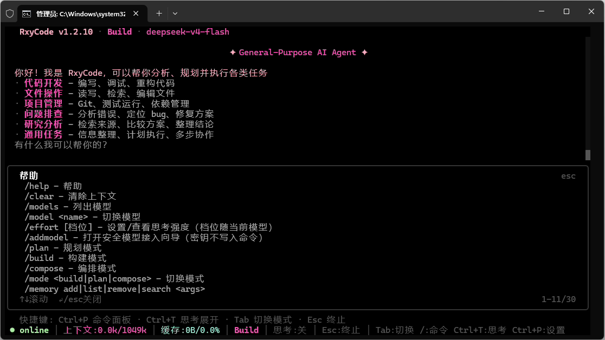
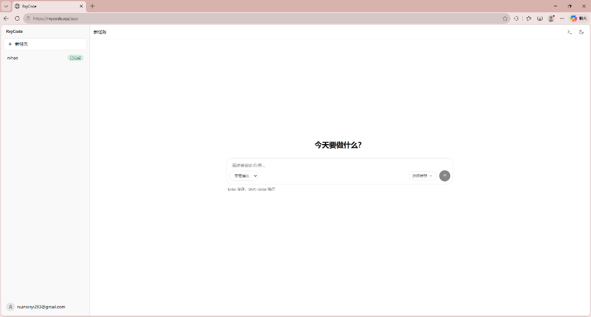

<!-- README_SYNC: source=working-tree; updated=2026-10-26 -->
<div align="center">

[English](./README.md) · **简体中文**

# RxyCode

**MIT 许可、带无头 Python 核心的编程 Agent。CLI/OpenTUI 跑在你自己的机器上，浏览器里用的是同一套 Harness。**

[⭐ 给仓库点 Star](https://github.com/xin-yi33/RxyCode) —— 如果你想要一个会规划、会调工具、写完会自己检查、危险操作先问你的本地 Agent，可以先收藏，也方便同样需求的人找到它。

[](https://github.com/xin-yi33/RxyCode/releases/tag/v1.4.5)
[](https://www.python.org/)
[](LICENSE)
[](https://github.com/xin-yi33/RxyCode/actions/workflows/ci.yml)
[](https://github.com/xin-yi33/RxyCode/actions/workflows/web-ci.yml)
[](https://github.com/xin-yi33/RxyCode/stargazers)

<p>
  
</p>

<p align="center"><sub>现有 OpenTUI 实机截图。v1.4.5 增加的是下文的终端打磨和内核改动；CLI 入口没有变化。</sub></p>

[⭐ 点 Star](https://github.com/xin-yi33/RxyCode) &nbsp;·&nbsp; [⚡ 快速开始](#-快速开始五步) &nbsp;·&nbsp; [🔑 差异在哪](#-差异在哪) &nbsp;·&nbsp; [🖥️ 使用界面](#️-使用界面) &nbsp;·&nbsp; [文档](docs/)

</div>

RxyCode 是一个既能本地跑、也能从浏览器用的编程 Agent。核心是无头 Python 进程（`Session` 包着 `AgentV2`）；OpenTUI、Ink 回退、Desktop 壳和 Web 控制台都是客户端。CLI 在你自己的机器上运行。云端 Web 的每个 turn 跑在云沙箱里，默认碰不到你的磁盘；只有你显式用 `rxycode connect` 配对一台机器，或者上传文件，才会跨过这条边界。

v1.4.5 的主要使用面仍是 CLI。它会拆任务、调工具、跑命令，并验证结果。你带一个 OpenAI 兼容的模型 Key；模型请求发往你配置的接口，不强制经过中转。

> **v1.4.5 · 2026-10-26。** 这次包含：持久 Shell、写后即时诊断、子代理协作工具、更严格的权限分档，以及 Web 的 BYOK 工作区（附件、产物清单、预览）。产品元数据是 `1.4.5`；JSON-RPC 仍是 `1.1.0`；导入命名空间 `RxyCode1_1_0` 不变。GitHub Release 只发布一个 sdist：`rxycode-1.4.5.tar.gz`——没有 wheel，没有新的 Desktop 安装包，也没有 PyPI 1.4.5。

---

## 🔑 差异在哪

**1. Shell 保留状态，但不保留授权。**
Agent 的交互式 `bash` 现在按会话复用一个受管 Shell，所以 `export`、`cd`、`source venv/bin/activate` 和 shell 函数能跨调用保留。每条命令仍然走同一套参数校验、风险分级、审批门、journal、输出上限和 OS 沙箱。取消或 Shell 崩溃会清掉整棵进程树并如实报告状态丢失，不自动重放上一条命令。`RXYCODE_MANAGED_SHELL=0` 可关闭这条路径；docker 模式仍是一容器一命令。

**2. 写完就检查。**
`write`、`edit`、`patch` 共用一个写后入口。Python 用真实 `compile()`，有 Ruff 时再跑一次；JavaScript 用 `node --check`；TS/TSX 用项目自己的 `tsc` 配置。结果把 `written` 和 `diagnostics.status` 分开，只有 `pass` 算通过。检查器缺失会报 `unavailable` 或 `not_checked`，不伪装成功。项目自带的可执行检查器配置（例如 ESLint flat config）需要显式信任；安全的那部分检查照常跑，也不会临时安装依赖。

**3. 子代理不只是能开，还能对话和归属。**
内置子代理（`explore`、`general`、`reviewer`、`scout`）有独立会话、上下文、工具范围、权限策略和预算。模型可以调用 `spawn_subagent`，选择 `sync`、`async` 或 `stream`；之后用 `send_message_to_subagent`、`list_agents`、`cancel_subagent` 协作。父子归属由运行时决定，子代理没法靠文本冒充。`/children` 看树，`@explore` 直接路由；`RXYCODE_SUBAGENTS=0` 回到单 Agent 基线。

**4. 权限分档，但有硬底线。**
`confirm_all` 自动放行读操作，但每次编辑和每条 shell 都要审批。`auto_edit` 连文件编辑也自动放行，shell 仍然要审批。`full_auto` 对普通工具不再弹审批，但永远不能越过硬黑名单。shell 的审批级别至少是 WRITE：READ shell 会提升为 WRITE，DANGER 命令保持 DANGER，不降级。Plan 模式在执行层就是只读，不只是提示词。写路径被限制在项目根目录或配置的输出目录内，决定会进审计日志。云端 Web 的 `full` 只是审批档位：turn 仍在每个 run 自己的沙箱里跑，挂载、网络策略和可写范围都不变。

**5. 一套 Harness，多个界面。**
OpenTUI 通过 `appserver` 走 stdio JSON-RPC；API 服务提供 HTTP + SSE；Web worker 调用同一个 `Session.prompt`。线协议仍是 `1.1.0`。工具发现也走同一套契约：MCP/插件 schema 通过 `tool_search` 按需加载，每次 MCP 工具调用都过同一个审批门和审计路径。所以 Agent 循环或工具契约的修复会同时作用到所有界面，而不是每个客户端各写一套。

**6. 云工作区把边界说清楚。**
Web 控制台只接受用户自己的 BYOK 模型 Key，没有平台模型兜底。run、事件、审批和产物持久化在 PostgreSQL。文件可以上传到租户工作区；跑完的文件会进入产物清单，带签名下载链接和图片/HTML/文本预览。云 run 默认碰不到你的电脑；`rxycode connect` 是显式设备桥，而且每条 shell 调用还要过本地审批收件箱。

---

## ⚡ 快速开始（五步）

### 1. 检查运行环境

需要 Python 3.10+。CLI 安装器会顺便准备 OpenTUI 需要的 Bun。Node.js 20+ 只在 Ink 回退或从源码跑 Desktop 时需要。

### 2. 从 tag 直接运行，或安装 CLI

```bash
uvx --from "git+https://github.com/xin-yi33/RxyCode.git@v1.4.5" rxycode
```

长期安装：

```bash
uv tool install --force --refresh "git+https://github.com/xin-yi33/RxyCode.git@v1.4.5"
```

macOS / Linux 一键安装：

```bash
curl -fsSL https://raw.githubusercontent.com/xin-yi33/RxyCode/v1.4.5/install.sh | sh
```

Windows PowerShell 一键安装：

```powershell
powershell -ExecutionPolicy Bypass -c "irm https://raw.githubusercontent.com/xin-yi33/RxyCode/v1.4.5/install.ps1 | iex"
```

安装器会创建隔离的工具环境，不改系统 Python 包。完整安装矩阵见 [docs/quickstart.md](docs/quickstart.md)。

### 3. 添加模型

```bash
rxycode
```

进入 OpenTUI 后运行 `/addmodel`。向导会用 Windows DPAPI 或 POSIX `0600` 凭证文件保存 Key，界面里始终脱敏，也不会写进对话记录。无头等价命令是 `rxycode config add-model <id> <provider-model-id> --base-url <url>`；Key 从 `RXYCODE_API_KEY` 读取，不接受命令行明文。

### 4. 给它一个任务

先从小任务开始：

```text
Create a single-file click-counter.html in this folder, then open it and verify the button increments.
```

需要写文件或跑 shell 时，审批门会问你。Plan 模式只能读和出计划，写操作会被执行层拒绝；Build 模式可以执行，结果在汇报前会先检查。

### 5. 选择使用界面

- **CLI / OpenTUI：** `rxycode`
- **无头 API：** `rxycode --api`（默认端口 `8765`）
- **Web：** [rxycode.xyz](https://rxycode.xyz) —— 早期预览；登录后带自己的模型 Key
- **Desktop：** 源码在 `frontend/desktop-app/`；v1.4.5 不发布新的 Desktop 二进制。`rxycode gui` 只拉起已经安装好的 Desktop 目录。

---

## 📦 安装与发布物

v1.4.5 的 GitHub Release 只发布一个资源：`rxycode-1.4.5.tar.gz`（源码分发包）。v1.4.5 发布**不包含** wheel、`.exe`、`.dmg` 或 `.AppImage`，也没有 PyPI 1.4.5。`.github/workflows/release.yml` 会在上传前拒绝非 sdist 产物。

从下载好的 sdist 安装：

```bash
python -m pip install --no-cache-dir --force-reinstall rxycode-1.4.5.tar.gz
```

升级已有 CLI：

```bash
uv tool install --force --refresh "git+https://github.com/xin-yi33/RxyCode.git@v1.4.5"
```

从源码安装：

```bash
git clone https://github.com/xin-yi33/RxyCode.git
cd RxyCode
python -m venv .venv
# Linux / macOS:
source .venv/bin/activate
# Windows:
# .venv\Scripts\activate

pip install -e .
rxycode
```

Docker：

```bash
docker compose up -d api
docker compose run --rm tui
```

compose 栈在内部网络的 `8765` 端口监听，并要求 `.env` 里设置 `RXYCODE_API_TOKEN`；需要从宿主机访问就自己加 `ports:` 映射。TUI 服务需要交互式 TTY。

### Desktop

1.4.5 没有新的 Desktop 安装包。Electron 源码仍在 `frontend/desktop-app/`，可以 `npm install && npm run dev` 从源码跑。要打包好的安装包，仍可从历史 Release（例如 [v1.3.0](https://github.com/xin-yi33/RxyCode/releases/tag/v1.3.0) 和 [v1.2.10](https://github.com/xin-yi33/RxyCode/releases/tag/v1.2.10)）下载；它们都不是 1.4.5 构建。v1.2.10 的 Windows 便携版真实资产名是 `RxyCode.Desktop-1.2.10-win.zip`，安装器是 `rxycode-desktop-1.2.10-setup.exe`；两者都是历史包，不是 1.4.5 安装包。`rxycode gui` 只从 `~/.rxycode/desktop`、`RXYCODE_DESKTOP_DIR` 或 `--desktop-dir` 拉起已安装的目录；只装 CLI 是打不开 Desktop 的。细节见 [docs/GUI.md](docs/GUI.md)。

---

## 🖥️ 使用界面

### CLI / OpenTUI

OpenTUI 是默认终端客户端，显示流式文本、工具调用、审批、子代理树、思考和 Todo 清单。

| 按键 | 作用 |
|---|---|
| `Tab` | 切换 Build / Plan / Compose |
| `Ctrl+P` | 命令面板 |
| `Ctrl+T` | 展开/收起思考 |
| `Ctrl+E` | 展开/收起 Todo |
| `Enter` | 发送 |
| `Shift+Enter` / `Ctrl+Enter` | 换行 |
| `Esc` | 取消或关闭弹层 |
| `Ctrl+C` | 复制 / 取消 / 清空；2 秒内两次退出 |

| 命令 | 作用 |
|---|---|
| `/build` | 规划、执行、验证 |
| `/plan` | 只读分析与计划 |
| `/compose` | 计划后接构建 |
| `/addmodel` | 添加供应商 |
| `/models` `/model <name>` | 查看 / 切换模型 |
| `/permission` | `confirm_all` / `auto_edit` / `full_auto` |
| `/agents on` `/team <task>` | 专家团（默认关） |
| `/children` `/child` `/parent` | 子代理树 |
| `/memory add/list/search` | 跨会话事实 |
| `/language` | 界面语言 |
| `/help` | 完整命令参考 |

默认工作模式是 Build。Plan 在执行层只读。Compose 是先计划再构建。专家团默认关闭，适合可拆分的大型工作，不是日常编辑的默认路径。

### 无头 API

```bash
rxycode --api
```

这是 FastAPI 的 HTTP + SSE 适配层，不是交互式 TUI。它和其他客户端共用同一个 `Session` 和协议映射。

## 🌐 RxyCode Web

线上实例是 [rxycode.xyz](https://rxycode.xyz)。它跑在一台资源有限的社区 VM 上，属于早期预览，不是生产 SLA。

<p>
  
</p>

<p align="center"><sub>现有 v1.4.4 控制台截图；v1.4.5 增加的是下文的交互和附件改动。</sub></p>

- **只用 BYOK。** 控制台只列出用户自己的模型连接；平台模型引用会被拒绝，没有管理员旁路。
- **持久 run。** PostgreSQL 保存 run、事件、审批和租约；Redis 只做 SSE 扇出，不是事实源。
- **附件。** 可以选择、粘贴或拖入文件；run 在事务里把暂存附件绑定到任务。DOCX/XLSX/PPTX 和 ODT/ODS/ODP 的正文抽取是内置的；导入失败会让 run 失败，不会静默丢文件假装成功。
- **产物与预览。** turn 结束后，变更文件进入产物清单，带签名下载链接。HTML/文本预览从私有桶经 CSP sandbox 提供；图片按图片流式返回。PDF/Office 预览不做承诺。
- **问题卡与时间线。** 问题卡按顺序竖排、单选、只提交一次；思考和任务清单可展开。这些是模型输出和 run 事件，不是宿主机内部状态。
- **移动端与旧 Chromium。** 控制台在 390px 视口和 Chromium 90/98/148 上验证过；Playwright 的 Firefox/WebKit 也覆盖关键路径。真实 iOS/Vivo 真机没有验证。
- **设备桥。** `rxycode connect --url <wss-url> --code <one-time-code> --device-id <name> --capability shell` 让本机主动外拨 WSS 配对。之后云端可以把 shell 调用下发到这台机器，每条都要过审批收件箱，而且被约束在 `connect` 启动时的目录内。

下表是发布证据映射，不承诺所有部署形态能力一致。`shipped` 行必须同时能定位磁盘证据目录和测试；`experimental` 表示代码与测试已存在，但还没有独立发布证据包；`blocked` 行直接写明当前限制。

| 能力 | 状态 | 证据 | 验证 |
|---|---|---|---|
| 租户登录与 CSRF/Origin 写入门 | shipped | `evidence/web/WEB-W2-C02` | `tests/web/w2/test_w2_c02_module.py` |
| 带 fencing worker lease 的持久 run | shipped | `evidence/web/WEB-W2-C03` | `tests/web/w2/test_w2_c03_module.py` |
| Event Store、outbox、SSE 重放与重连 | shipped | `evidence/web/WEB-W7-C02` | `tests/web/w7/test_w7_c02_module.py` |
| 审批/问题状态持久化与跨天恢复契约 | shipped | `evidence/web/WEB-W2-C06` | `tests/web/w2/test_w2_c06_unit.py` |
| React 工作台：登录、会话、diff、PTY 与产物 | shipped | `evidence/web/WEB-W3-C06` | `tests/web/w3/test_w3_c06_module.py` |
| 本机 Full Runner、设备配对与急停 | shipped | `evidence/web/WEB-W4-C06` | `tests/web/w4/test_w4_c06_module.py` |
| 邮箱验证码、ALTCHA 与限频 | shipped | `evidence/web/WEB-W9-C01` | `tests/web/w9/test_rate_and_device.py`, `tests/web/w9/test_email_codes.py` |
| 单设备登录锁 | shipped | `evidence/web/WEB-W9-C01` | `tests/web/w9/test_rate_and_device.py` |
| BYOK 密钥库与模型选择器 | shipped | `evidence/web/WEB-W10-C01` | `tests/web/w9/test_byok_api.py`, `tests/web/w9/test_byok_crypto.py` |
| 附件暂存、事务绑定与文档正文抽取 | experimental | — | `tests/web/w11/test_w11_c07_unit.py`, `tests/web/w11/test_w11_attachments_staging.py` |
| 产物清单、签名下载与 Range | shipped | `evidence/web/WEB-W3-C06` | `tests/web/w11/test_w11_c07_unit.py` |
| 图片、HTML 与文本预览 | experimental | — | `tests/web/w11/test_w11_c09_unit.py` |
| 会话工作区文件列表与下载 | shipped | `evidence/web/WEB-W12-C01` | `tests/web/w9/test_session_files.py` |
| 设备桥与本机审批收件箱 | shipped | `evidence/web/WEB-W13-C01` | `tests/web/w4/test_w4_c05_module.py` |
| per-run 云沙箱与租户文件系统隔离 | shipped | `evidence/web/WEB-W5-C02` | `tests/web/w5/test_w5_c02_unit.py` |
| 可复现 Agent 评测与基线对照 | shipped | `evidence/web/WEB-W7-C03` | `tests/web/w7/test_w7_c03_unit.py` |
| OpenTelemetry span 与 per-run 费用账本 | shipped | `evidence/web/WEB-W7-C04` | `tests/web/w7/test_w7_c04_unit.py` |
| Compose 部署、HTTPS 网关与受限 turn | shipped | `evidence/web/WEB-W7-C05` | `tests/web/w7/test_w7_c05_module.py` |
| 认证、注入与数据泄漏安全审查语料 | shipped | `evidence/web/WEB-W7-C01` | `tests/web/w7/test_w7_c01_unit.py` |
| 公网人工浏览器冒烟：登录、BYOK、接管、取消、文件 | shipped | `evidence/web/WEB-W10-C02` | `tests/web/w9/test_e2e.py`, `tests/web/w9/test_version.py` |
| 托管 Demo URL | shipped | `evidence/web/WEB-W10-C02` | `tests/web/w9/test_version.py` |
| 匿名 HTTP 云端 run | blocked: 访客必须先登录才能发送任务 | — | — |
| 公共 worker 执行 `local:*` 目标 | blocked: cloud-only 放置闸拒绝本机目标 | — | — |
| PDF 与 Office 产物预览 | blocked: capability 如实返回 `pdf=false`, `office=false` | — | — |
| `apps/web` 独立 Playwright npm E2E target | blocked: 尚未提供独立 target 或依赖；`tests/web` 的 Python 浏览器测试仍然存在 | — | — |

公共 worker 只执行 `cloud:{tenant}:{workspace}` 目标，而且 turn 在 per-run 沙箱里跑。云 run 读不到你的 home 目录；上传文件或配对设备都是显式动作。自部署与边界见 [docs/deploy/web-runbook.md](docs/deploy/web-runbook.md)；用户指南见 [docs/product/web-user-guide.md](docs/product/web-user-guide.md)；设计见 [docs/architecture/web-system-design.md](docs/architecture/web-system-design.md)。

---

## 🏗️ 架构

```text
rxycode (OpenTUI) / rxycode gui / rxycode --api / Web browser
                     │
                     ▼  stdio JSON-RPC / HTTP+SSE / Web SSE
     appserver (worker subprocess + watchdog)   rxycode_server + worker
                     │                                   │
                     └─────────────────┬─────────────────┘
                                       ▼
                          Session (headless facade, no UI)
                                       │
                                       ▼
                                   AgentV2
   ┌──────────────────────────────────────────────────────────┐
   │ Simple query → fast path + exact-hash / semantic cache   │
   │                                                          │
   │ 日常 Build → 流式工具循环 + 构建工作流/验证              │
   │ /full 或 /pipeline、复杂 Compose → LangGraph DAG:        │
   │ goal planner → decomposer → parallel executor →           │
   │ validator → reflection → grounded synthesis               │
   │                                                          │
   │ Subagents: isolated child sessions + collaboration tools  │
   │ Expert team: Coordinator + deterministic SOP (off)        │
   │                                                          │
   │ Tools: built-ins + MCP + plugins, all via ToolOrchestrator│
   │ Safety: risk tiers, approval, hard denylist, audit,       │
   │         write whitelist, optional OS sandbox              │
   │ Memory: short-term / compressed / vector / code RAG       │
   └──────────────────────────────────────────────────────────┘
```

`appserver` 把每个会话隔离在 worker 子进程里。Web worker 再给每个 run 加 Linux user/PID/IPC/UTS namespace 沙箱；沙箱不可用时 run 直接失败，不会回落到宿主机执行。CLI 的可选 OS 沙箱（`execution.os_sandbox.enabled`，默认关）是另一条边界；权限档位不是沙箱开关。

MCP 服务器仍走 stdio。它们的工具和内置工具共用同一个 `ToolOrchestrator`、审批门、审计日志和重试策略。每个 server 的工具清单会记录 schema 面，变化时告警。工具定义可以用 `tool_search` 按需发现；完整 discovery 留在消息上下文里，不会每轮重发。插件 skill 和 MCP 条目通过 `plugin/list` 列出。

---

## 🛡️ 安全与权限

每次工具调用在执行前都会分级。

| 等级 | 例子 | 默认策略 |
|---|---|---|
| READ | read、grep、glob、抓网页 | 自动放行 |
| WRITE | 文件编辑、普通 shell | 审批，受档位影响 |
| DANGER | 安装器、`git push --force`、破坏性 shell | 审批；命中硬黑名单不执行 |

三档权限：

| 档位 | 读 | 文件编辑 | Shell |
|---|---|---|---|
| `confirm_all` | 自动 | 询问 | 询问 |
| `auto_edit` | 自动 | 自动 | 询问 |
| `full_auto` | 自动 | 自动 | 自动，硬黑名单除外 |

shell 的审批级别至少是 `WRITE`：READ shell 会提升为 `WRITE`，DANGER 命令保持 `DANGER`，不会被降级。所以 `auto_approve: ["write"]` 不能放行破坏性命令。

额外的边界：

- **硬黑名单在审批之前。** 递归删除系统根、格式化磁盘、直接写设备、关机重启这类灾难命令会在审批前拒绝。它是基于模式的兜底，不是数学证明；处理不可信任务时仍应保留 OS 沙箱和审批门。
- **写白名单。** 写到项目根和配置输出目录之外的路径会失败关闭。
- **Plan 只读。** 即使模型请求写，执行层也会拒绝。
- **审计日志。** 决定和工具调用写入 `~/.RxyCode/logs/audit.jsonl`，凭证和 API token 会脱敏。
- **演练模式。** `RXYCODE_DRY_RUN=1` 只模拟，不产生磁盘或网络副作用。
- **Web 沙箱。** 云端 worker 永远把 turn 放在 per-run 沙箱里。Web 的 `full` 只取消沙箱内的审批提示，不会增加宿主机挂载或网络权限。
- **设备桥。** 配对机器在本机执行 shell，走自己的审批收件箱，并被限制在 `rxycode connect` 启动时的目录内。

### 模型流量

程序、工作区、Key 和审计日志留在你的机器上。调用云端模型时，请求里会有当前 prompt 和 system 指令、仍在上下文窗口里的近期对话、本次已经由工具返回的文件片段/diff/命令输出，以及你使用视觉时的图片。整个仓库不会自动上传。`websearch` 把查询发给配置的搜索服务；`webfetch` 访问目标 URL；MCP server 能看到它自己的工具返回的内容。

---

## ⚙️ 配置

配置在 `~/.RxyCode/config.yaml`；默认输出目录是 `~/.RxyCode/output/`。

| 环境变量 | 用途 |
|---|---|
| `RXYCODE_DATA_DIR` | 覆盖数据/配置目录 |
| `RXYCODE_OUTPUT_DIR` | 覆盖生成文件输出目录 |
| `RXYCODE_API_KEY` | `rxycode config add-model` 读取的 Key |
| `RXYCODE_DRY_RUN=1` | 只模拟，不产生副作用 |
| `RXYCODE_MANAGED_SHELL=0` | 关闭持久 Shell |
| `RXYCODE_SUBAGENTS=0` | 关闭子代理派发 |
| `RXYCODE_TUI=ink` | 使用 Ink 回退界面 |
| `RXYCODE_DESKTOP_DIR` | 指定 `rxycode gui` 的 Desktop 目录 |

供应商预设包括 DeepSeek、Moonshot/Kimi、阿里云百炼通义千问、火山方舟豆包、智谱 GLM、SiliconFlow、OpenAI、Anthropic 兼容代理、OpenRouter 和 Groq。模型标识和能力是数据驱动的；用 `rxycode config list` 或 `/models` 看当前配置。

---

## 📦 环境要求

| 依赖 | 版本 | 说明 |
|---|---|---|
| Python | 3.10+ | 核心 Agent |
| Bun | 最新 | 默认 OpenTUI 运行时；安装器会准备 |
| Node.js | 20+ | Ink 回退或 Desktop 源码 |
| API Key | — | 任意 OpenAI 兼容供应商 |
| Docker | 当前版本 | 可选：Docker 部署与 Web 自托管 |

CI 覆盖 Linux Python 3.11/3.12 和 Windows。本次发布没有在 macOS 实机跑过。

---

## 📋 版本历史

| 版本 | 日期 | 要点 |
|---|---|---|
| [v1.4.5](https://github.com/xin-yi33/RxyCode/releases/tag/v1.4.5) | 2026-10-26 | 持久 Shell、写后即时诊断、子代理协作、权限分档、Web BYOK 工作区（附件/产物/预览）。产品元数据 1.4.5；协议 1.1.0；只发 sdist |
| [v1.4.4](https://github.com/xin-yi33/RxyCode/releases/tag/v1.4.4) | 2026-10-22 | RxyCode Web 上线：托管控制台、持久 run、BYOK 密钥库、设备桥、3 worker 上限。产品元数据 1.4.4；协议 1.1.0 |
| [v1.4.3](https://github.com/xin-yi33/RxyCode/releases/tag/v1.4.3) | 2026-10-14 | 按需 MCP schema、写入检查、硬 shell 黑名单、200 行输出落盘、工具审计指标 |
| [v1.4.2](https://github.com/xin-yi33/RxyCode/releases/tag/v1.4.2) | 2026-10-09 | Todo 台账/终端面板、状态带、增量压缩、大输出落盘、默认关闭的超时决策 |
| [v1.4.1](https://github.com/xin-yi33/RxyCode/releases/tag/v1.4.1) | 2026-10-07 | CLI 维护：可选 OS 沙箱、Windows venv Job 绑定、日志保留、重试/熔断 |
| [v1.4.0](https://github.com/xin-yi33/RxyCode/releases/tag/v1.4.0) | 2026-09 | 只发 CLI/OpenTUI：会话、`/effort`、计划审批、共享重试、Shift+Enter |
| [v1.3.0](https://github.com/xin-yi33/RxyCode/releases/tag/v1.3.0) | 2026-09 | Desktop 工作台：三栏工作区、权限分档；Windows/Linux 包 |
| [v1.2.11](https://github.com/xin-yi33/RxyCode/releases/tag/v1.2.11) | 2026-08 | 10 角色 7 阶段专家团；Windows 编码；8MB stdio 吞吐 |
| [v1.2.10](https://github.com/xin-yi33/RxyCode/releases/tag/v1.2.10) | 2026-08 | Electron Desktop、Plan 模式、Goal 弹窗、Composer 菜单 |
| [v1.2.9](https://github.com/xin-yi33/RxyCode/releases/tag/v1.2.9) | 2026-08 | 隔离子代理：`@agent`、Task 工具、子代理树 |
| [v1.0.0](https://github.com/xin-yi33/RxyCode/releases/tag/v1.0.0) | 2026-06 | LangGraph 重写：规划-执行、分层记忆、代码 RAG |
| [v0.3.3](https://github.com/xin-yi33/RxyCode/releases/tag/v0.3.3) | 2025-12 | 首个公开版本：工具链与 MCP |

完整更新历史见 [CHANGELOG.md](CHANGELOG.md)；每版说明见 [docs/release-notes/](docs/release-notes/)。v1.4.5 的说明是 [RELEASE_NOTES_v1.4.5.md](docs/release-notes/RELEASE_NOTES_v1.4.5.md)。

---

## ⚠️ 已知限制

- **v1.4.5 的 Web E2E 没有全绿。** 300 秒验收 run 的目标完成了（`ELAPSED=300.000691652298`），也产生了真实的 180.003 秒判活检查点（5 秒观察窗口、3 个进程、CPU/IO 0、owner BYOK 返回 `continue`、UI 可见）。之后模型又请求了一次额外文件检查审批（`ca7505f206d446169e16ff98ba0f38ed`），run 被 owner 自己取消，终态是 `cancelled`，不是自然 `succeeded`。额外审批的原因是 **OPEN** 现象，没有确认为产品 bug。
- **判活结果只有一次 run、一个模型。** 它不代表所有模型、供应商或长命令。经用户批准，额外的固定 15 秒判活等待已移除；P6 的 15 秒 decision clock、任务/工具预算、续期、权限和杀进程规则都没有改。
- **平台覆盖不均。** Linux 3.10 容器（Python 3.12）和 Windows 有真实证据；本次没有在 macOS 实机跑过。不要把 CI 徽章理解成全平台真机承诺。
- **Web 控制台是早期预览。** 它跑在一台小 VM 上，worker 上限 3，没有 SLA。PDF/Office 预览不支持。真实 iOS/Vivo/Safari 没有验证；验证过的是 Chromium 90/98/148 和 Playwright 的 Firefox/WebKit。
- **Web 的 BYOK-only 是策略变化。** 平台模型兜底已移除；托管 run 需要用户自己的模型连接。本地 CLI 行为不变。
- **发布范围。** v1.4.5 只发一个 sdist，没有 Desktop 二进制，也没有 PyPI 1.4.5。旧 Release 上的 Desktop 包不是 1.4.5 构建。
- **CI 基线。** 历史基线：源码 `247be96e` 的 CI `40166956475` 为 6/6 job；docs `63fcde7b` 的 CI `40173191825` 为 6/6。这些运行不能证明 v1.4.5 tag；tag 需要自己的新 CI 结果。

---

## 🤝 参与贡献

提交 PR 前请先读 [CONTRIBUTING.md](CONTRIBUTING.md)。欢迎 Issue 和聚焦的 bug 报告。给 Agent 看的模块说明从 [docs/agent/README.md](docs/agent/README.md) 开始。

## 📄 开源许可证

[MIT](LICENSE) © RxyCode contributors。

如果 RxyCode 对你有用，可以[点一个 Star](https://github.com/xin-yi33/RxyCode)，方便以后回来。Bug 和建议请提 [Issues](https://github.com/xin-yi33/RxyCode/issues)。
