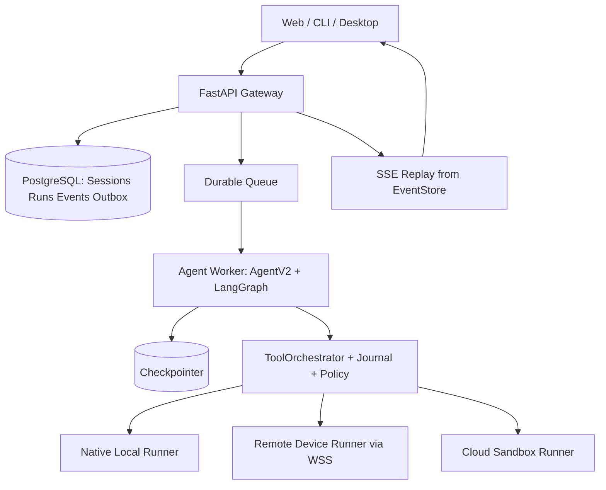

# 目标架构与模块边界合同

> **Status**：Accepted as plan；正式代码路径需在 W0-C02 `rg` 确定。**与旧 ARCH-001“一个 Agent Loop”一致**。

## §1 最终拓扑



**Core**（纯 Agent 决策与 tool interface）→ **Worker**（Run 生命周期/Graph 推理）→ **Runner**（OS 真实操作）；**Server** 对 HTTP/Auth/Ownership/Event authority 负责；**UI** 只能投影服务端事件。**DB 不是 Agent 的 Tool Storage 替代**。

## §2 运行时边界与包依赖

```text
rxycode_protocol (Pydantic DTO, Error, Version, JSON Schema)
       ↑             ↑                ↑
rxycode_core        server            runner
       ↑             ↑                ↑
      worker --------┘-- rpc client --┘
       ↑
  Local CLI/Desktop adapters, Cloud Worker supervisor
Web TS 只使用 generated protocol types 和 HTTP/SSE/WS client
```

**依赖约束**：`core` 可依赖纯协议 DTO，但不能 import `server`, `worker`, `runner`, `FastAPI`, `Electron` 或操作某设备的具体 OS SDK；Core 通过 `ExecutionPort` 调用；Worker 持有 Agent 生命周期，Server 持有业务 Run 状态，Runner 持有本机 OS 状态；Server 不能从 HTTP handler 直接跑 LLM graph。

## §3 完整目标项目结构

```text
packages/
  rxycode-core/src/rxycode_core/{agent,graph,harness,tools,memory,runtime}/
  rxycode-protocol/src/rxycode_protocol/{commands,events,toolrpc,models}/
  rxycode-server/src/rxycode_server/{api,auth,runs,sessions,persistence,devices,events}/
  rxycode-worker/src/rxycode_worker/{supervisor,checkpoint,scheduler,lifecycle}/
  rxycode-runner/src/rxycode_runner/{local,remote,sandbox,browser,desktop,transport}/
apps/
  web/src/{app,features,components,lib,generated}/
  desktop/  # Electron host
  cli/      # Python Click/OpenTUI entrypoints
infra/
  compose/ k8s/ (K8s 只在多节点证据明确后交付)
  migrations/
```

注意：旧根目录 `core/`, `execution/`, `protocol/`, `appserver/`, `frontend/` 迁移期间允许适配层；W1-C01 必须先验证 wheel/install。**不允许把同一文件 copy 到两个包而在运行时产生两个 Agent 类身份**。

## §4 RunContext / ExecutionPort 单一定义

```python
@dataclass(frozen=True)
class RunContext:
    tenant_id: str
    actor_id: str
    project_id: str
    session_id: str
    run_id: str
    target_id: str
    permission_profile: str
    deadline_at: datetime
    trace_id: str

@dataclass(frozen=True)
class TargetCapabilities:
    target_id: str
    kind: Literal['local', 'remote', 'cloud']
    capabilities: frozenset[str]
    os: str
    arch: str
    protocol_version: str

class ExecutionPort(Protocol):
    async def invoke(self, call: ToolInvocation) -> AsyncIterator[ToolEvent]: ...
```

**约束**：`RunContext` 序列化后跨进程/设备显式传递；设备 token 或模型密钥不进入 DTO、日志或 Prompt。Executor 在实际调用之前做 Policy + Journal，然后选择目标；Runner 才能执行。`TargetCapabilities` 不是授权，而是能力发现，授权仍单独检查。

## §5 Local Native / Remote / Cloud 路由语义

| Target | Agent Worker | ToolBackend | Sandbox | 权限上限 |
|---|---|---|---|---|
| `local:<host>` | Local | NativeBackend | Full 为 false；Ask/Auto 按配置 | 本机用户显式选择 |
| `remote:<device>` | Cloud/Local | RunnerRPC → Device NativeBackend | Remote Full 为 false | 设备 Owner 本机授权；服务端不能提升 |
| `cloud:<sandbox>` | Cloud | SandboxBackend → sandboxd | true；隔离强制 | 租户工作区资源边界 |

**解释**：`Full` 是审批预设，不是执行目标。`Target` 是运行位置。`cloud + full` 仍必须在隔离云端工作区执行。**Native Full 不被 gVisor/WSL/Docker 冒充**。

## §6 六条技术 ADR 锁定

- [ADR-WEB-001](adr/ADR-WEB-001-ONE-CORE-MANY-SURFACES.md)：唯一 Agent Loop。
- [ADR-WEB-002](adr/ADR-WEB-002-EVENT-SOURCE-OF-TRUTH.md)：DB EventStore + replay-follow。
- [ADR-WEB-003](adr/ADR-WEB-003-RUNNER-BOUNDARY.md)：工具与环境分离，Native Full 真直通。
- [ADR-WEB-004](adr/ADR-WEB-004-PERMISSION-LOCAL-AUTHORITY.md)：本机 grant 权威。
- [ADR-WEB-005](adr/ADR-WEB-005-DURABILITY-AND-SIDE-EFFECTS.md)：Checkpoint ≠ Journal。
- [ADR-WEB-006](adr/ADR-WEB-006-MONOREPO-MIGRATION.md)：物理迁包应在接口和基线冻结后。

## §7 禁止的互相污染

- Web 直接读 `task_store.py` 私有 JSON、直接调用 `/chat/stream` 旧接口、在 localStorage 创建权威 Session；全部禁止。
- Cloud Server import 任何 NativeBackend 后自动执行本机命令；禁止。
- Runner/Browser 读取云端完整模型 API Key；禁止。
- UI 根据工具字符串（如 `bash`）猜风险级别后直接批准；禁止。
- 单独开发 Web Agent 的第二套 `create_react_agent` 或 `AgentV2`；禁止。
